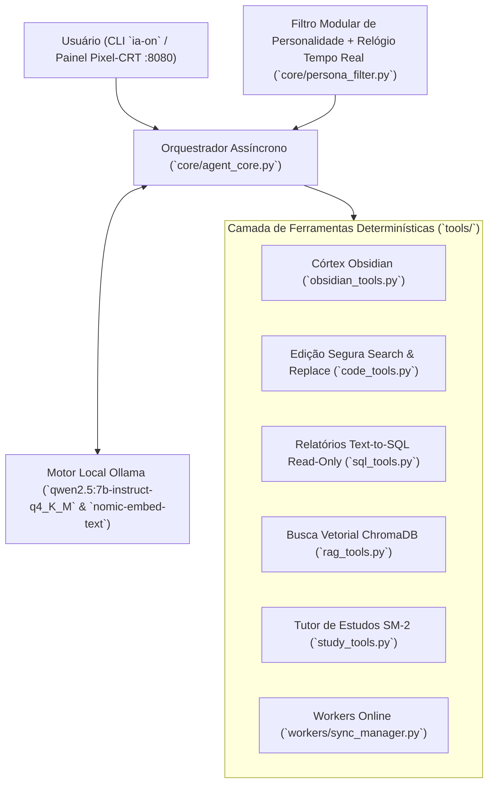

# ⚡ Hybrid Local AI & Retro Pixel-CRT Control Deck

Sistema Agêntico Local Híbrido (**Offline-First**) em Python 3.11+, projetado para máxima eficiência em GPUs dedicadas a partir de **6GB de VRAM** (ex: NVIDIA RTX 4050) com **Ollama**, **Córtex Neural no Obsidian (PKM)**, **Zero Alucinação Matemática (Text-to-SQL Read-Only)**, **RAG Local com ChromaDB**, **Repetição Espaçada SuperMemo-2 (SM-2)** e **Painel Desktop Desacoplado (FastAPI + Webview 16-Bit Pixel-CRT)**.

---

## 🏛️ Visão Geral da Arquitetura



### Limites e Parâmetros de Hardware Otimizados
- **Modelos Locais (Ollama)**:
  - Raciocínio, Código e Tool Calling: `qwen2.5:7b-instruct-q4_K_M`
  - Embeddings Vetoriais (RAG): `nomic-embed-text`
- **Parâmetros de Inferência**:
  - `num_ctx: 4096` (protege o limite de 6GB de VRAM com Flash Attention e cache KV `q8_0`)
  - `temperature: 0.1` na seleção/execução determinística de ferramentas e queries SQL
  - `temperature: 0.6` na síntese de resposta criativa, diários e aplicação de persona
  - `keep_alive: "5m"`
- **Critério de Parada**: `MAX_TOOL_ITERATIONS = 3` (interrompe loops automaticamente após 3 falhas).

---

## 🧩 Passo a Passo das 5 Fases e Cada Funcionalidade

### FASE 1 — Fundação, Percepção Temporal, Filtro de Personalidade e Loop Agêntico
1. **`config.py` (`Settings`)**:
   - Carrega variáveis do arquivo `.env` de forma tipada via `pydantic-settings` usando caminhos portáveis relativos à raiz do projeto (`BASE_DIR`).
   - `ensure_directories()`: Inicializa automaticamente a estrutura do Vault (`00_Persona`, `01_Skills`, `02_Agentes`) e dos bancos (`database/`).
2. **`core/persona_filter.py` (`PersonaFilter`)**:
   - `load_persona()`: Carrega a identidade da IA a partir de `obsidian_vault/00_Persona/personalidade_principal.md` com cache inteligente por `mtime` (recarrega instantaneamente se editado no Obsidian).
   - `get_realtime_temporal_block()`: Injeta data, hora exata, dia da semana e fuso horário (`TIMEZONE`) no System Prompt antes de **cada** inferência do LLM.
   - `build_system_prompt(mode)`: Separa o modo determinístico (`mode="tools"`, que isola as chamadas JSON de ferramentas da estilização da persona) do modo de síntese (`mode="creative"`).
3. **`core/agent_core.py` (`LocalHybridAgent`)**:
   - `chat()`: Orquestra o ciclo completo de conversação assíncrona com o Ollama (`AsyncClient`), executando ferramentas com `temperature=0.1`, impondo parada em `MAX_TOOL_ITERATIONS = 3` e sintetizando a resposta final com `temperature=0.6`.
   - Ferramentas de diagnóstico nativas: `get_hardware_and_runtime_status()` e `list_vault_structure()`.

---

### FASE 2 — Córtex Neural no Obsidian & Edição Segura de Código
1. **`tools/obsidian_tools.py` (Autonomia Total dentro de `OBSIDIAN_VAULT_PATH`)**:
   - `_resolve_safe_vault_path()`: Garante isolamento estrito dentro do Vault, bloqueando *Path Traversal* (`../`).
   - `read_obsidian_note(relative_path)`: Lê notas Markdown e extrai conexões `[[wikilinks]]`.
   - `write_obsidian_note(relative_path, content, tags_csv, mode)`: Cria ou atualiza notas (`overwrite` ou `append`) sem pedir confirmação `[S/N]`, gerando frontmatter YAML padronizado.
   - `append_daily_journal_entry(entry_text, section_Or_event)`: Registra entradas e eventos na Nota Diária (`03_Diario/YYYY-MM-DD.md`) com carimbo de hora exato.
   - `search_obsidian_vault(query)`: Pesquisa notas por título, tags, `[[wikilinks]]` e conteúdo.
   - `manage_obsidian_skill(action, skill_name, ...)`: Lista, lê e cria/atualiza dinamicamente Skills em `/01_Skills/`.
   - `manage_obsidian_subagent(action, agent_name, ...)`: Lista, lê e cria/atualiza dinamicamente Sub-Agentes Especialistas em `/02_Agentes/`.
2. **`tools/code_tools.py` (Proteção Estrita fora do Vault em `ALLOWED_CODE_DIRS`)**:
   - `_resolve_allowed_code_path()`: Restringe o acesso exclusivamente aos diretórios listados em `ALLOWED_CODE_DIRS`.
   - `list_allowed_code_files(directory_path, pattern)`: Lista arquivos de código ignorando `.venv`, `.git`, `__pycache__` e `node_modules`.
   - `read_code_file(file_path, start_line, end_line)`: Leitura paginada com linhas numeradas para economizar contexto.
   - `apply_code_diff(file_path, search_block, replace_block, create_backup)`: Opera **exclusivamente** por blocos *Search & Replace* exatos (rejeita se o bloco não existir ou for ambíguo), gera diff unificado, solicita confirmação `[S/N]` no terminal e cria backup automático em `.code_backups/<arquivo>.bak.<timestamp>`.

---

### FASE 3 — SQLite Offline-First, Zero Alucinação Matemática, RAG e Tutor SM-2
1. **`database/db_manager.py` (`DatabaseManager`)**:
   - Banco SQLite local em modo `WAL` com tabelas para cache offline de e-mails (`emails_cache`), mensagens (`messages_cache`), calendário (`calendar_events`), flashcards (`study_cards`, `study_reviews_log`) e auditoria de sincronização (`sync_status_log`).
   - `get_connection(read_only=True)`: Abre conexão URI `mode=ro` com `PRAGMA query_only = ON`.
2. **`tools/sql_tools.py` (Zero Alucinação Matemática)**:
   - `inspect_sql_schema()`: Retorna todas as tabelas, colunas, tipos e contagens de registros.
   - `run_sql_report(sql_query)`: Executa **exclusivamente** queries `SELECT`/`WITH` em modo Read-Only para contagens e relatórios exatos, bloqueando qualquer palavra-chave de mutação (`INSERT`, `UPDATE`, `DELETE`, `DROP`, etc.).
   - `schedule_local_calendar_event(...)`: Agenda compromissos localmente na tabela `calendar_events`.
3. **`tools/rag_tools.py` (`LocalVaultRAG` com ChromaDB + `nomic-embed-text`)**:
   - `index_obsidian_to_rag()`: Divide as notas Markdown do Vault em chunks semânticos, gera embeddings locais com `nomic-embed-text` e faz upsert na coleção persistente do ChromaDB.
   - `query_rag_knowledge(query, top_k)`: Busca semântica vetorial por similaridade de cosseno 100% offline.
4. **`tools/study_tools.py` (Repetição Espaçada SuperMemo-2)**:
   - `create_study_flashcard(deck, front, back, source_note)`: Cria novos cartões de estudo vinculados às notas do Obsidian.
   - `get_due_study_flashcards(deck, limit)`: Lista cartões pendentes para revisão na data atual (`next_review_date <= hoje`).
   - `review_study_flashcard_sm2(card_id, quality)`: Calcula determinísticamente o novo Fator de Facilidade (`EF >= 1.3`), intervalo em dias e próxima data de revisão segundo a fórmula oficial SM-2 para notas de `0` a `5`.

---

### FASE 4 — Painel de Configurações Desktop (FastAPI + Webview Retro Pixel-CRT)
1. **`gui/backend/server.py` (Servidor FastAPI Local em `127.0.0.1:8080`)**:
   - `GET /api/telemetry`: Monitor em tempo real de VRAM da GPU NVIDIA (`nvidia-smi`), offload de modelos no Ollama (`/api/ps`), RAM, SSD e contagens SQLite.
   - `POST /api/offline-mode`: Botão de Emergência (**Kill-Switch "Modo Estritamente Offline"**) que ativa `STRICT_OFFLINE_MODE=true` instantaneamente.
   - `GET /api/browse-folders` & `POST /api/directories`: Seletor visual de pastas para `OBSIDIAN_VAULT_PATH` e `ALLOWED_CODE_DIRS`.
   - `POST /api/credentials` & `GET /api/whatsapp/qr`: Cofre local `.env` para Discord Bot Token, Google OAuth2 e matriz QR Code do WhatsApp.
   - `POST /api/persona`, `POST /api/rag/reindex` & `POST /api/agent/chat`: Editor da persona em tempo real, indexação RAG e console interativo.
2. **`gui/frontend/` (`index.html`, `styles.css`, `app.js`)**:
   - Interface 100% offline e responsiva em estilo **16-Bit Green Phosphor Pixel-CRT**, zero dependências JS externas, poupando RAM e VRAM.

---

### FASE 5 — Workers Assíncronos de Sincronização Online
1. **`workers/sync_manager.py` (`SyncManager`)**:
   - Workers independentes (`DiscordSyncWorker`, `GmailSyncWorker`, `GoogleDriveSyncWorker`, `WhatsAppSyncWorker`) executados concorrentemente via `asyncio.gather`.
   - Respeitam estritamente o **Kill-Switch `STRICT_OFFLINE_MODE`**: quando ativo, bloqueiam qualquer conexão externa e registram `OFFLINE_SKIPPED` em `sync_status_log`.
   - Tools expostas ao agente: `trigger_online_sync(platform)` e `get_sync_workers_status(limit)`.

---

## 🚀 Instalação e Inicialização Rápida (`ia-on`)

### 1. Pré-requisitos
- Python 3.11+
- [Ollama](https://ollama.com) instalado (em GPUs NVIDIA no Arch/CachyOS, recomenda-se `ollama-cuda`):
  ```bash
  ollama pull qwen2.5:7b-instruct-q4_K_M
  ollama pull nomic-embed-text
  ```

### 2. Clonar e Configurar Ambiente
```bash
git clone git@github.com:and-o-re/local-hybrid-ai.git
cd local-hybrid-ai
cp .env.example .env
python -m venv .venv
source .venv/bin/activate
pip install -r requirements.txt
```

### 3. Iniciar com o Comando Único `ia-on`
Você pode iniciar todo o ecossistema (Daemon Ollama CUDA + Servidor FastAPI `:8080` + Janela Desktop Pixel-CRT + Chat CLI Interativo) com:
```bash
./scripts/ia-on.sh
```
*(Ou instalando o comando global `ia-on` em `~/.local/bin/ia-on` para chamar `ia-on` de qualquer diretório no terminal).*

#### Outros Modos de Execução:
```bash
# Validar percepção temporal e leitura de persona sem chamar o LLM:
python main.py --check

# Executar um prompt único via terminal:
python main.py --prompt "Qual é o status da minha VRAM e quantos e-mails não lidos tenho no banco?"

# Abrir apenas o Painel de Configurações Desktop (127.0.0.1:8080):
python main.py --gui
```
